# OnCallRadar architecture

## Purpose

OnCallRadar combines a deterministic operational data service with an optional
AI-assisted triage workflow. The deterministic core collects operational
signals, correlates them with existing work items, applies configured rules,
and publishes a canonical `digest.json`. The AI layer consumes that artifact,
investigates evidence, and publishes a separate triage artifact.

Team and product behavior belongs in YAML configuration. Provider-specific
authentication values belong in the runtime environment or a secret store.
The deterministic core pipeline does not make LLM calls. The optional triage
workflow is non-deterministic by design and is governed by explicit approval
guardrails.

## Current runtime architecture

```mermaid
flowchart LR
    Config["config.yaml<br/>non-secret"] --> Loader["Config loader<br/>Pydantic + dotenv"]
    Env["Runtime environment<br/>.env locally / secret injection in prod"] --> Loader
    Loader --> Run["CLI: oncallradar run"]

    Run --> Sources["Source collection"]
    Sources --> Log["LogQuerySource<br/>KQL / ADX"]
    Log --> Normalize["Normalize rows<br/>to Signal"]
    Normalize --> Process["Generic processor"]

    Process --> Threshold["Threshold + aggregation"]
    Threshold --> Fingerprint["Template + SHA-256 fingerprint"]
    Fingerprint --> Sections["Configured sections"]

    Run --> Tracker["Azure DevOps tracker<br/>read-only"]
    Tracker --> Match["Work-item correlation"]
    Sections --> Match

    Match --> Suppress["Suppression rules<br/>git-tracked YAML"]
    Suppress --> Digest["DigestDocument v1"]
    Digest --> JSON["digest.json"]
    Digest --> HTML["HTML renderer"]
    HTML --> Report["digest.html"]

    JSON --> Skill["Copilot skill<br/>oncall-triage"]
    Skill --> Investigate["Read-only investigation tools"]
    Investigate --> Triage["triage-YYYY-MM-DD.json"]
    Triage --> TriageHTML["triage HTML renderer"]

    Health["Source health + failures"] --> Digest
```



## Run sequence

1. The CLI loads the tracked YAML configuration.
2. Local development may load `.env`; production uses injected environment
   variables or secret references.
3. Environment references such as `$(VAR)` and `${VAR:-default}` are resolved.
   Missing or empty required variables are reported by name only.
4. Configured log-query sources run concurrently.
5. Each source returns normalized `Signal` records and a `SourceHealth` result.
6. The generic processor:
   - groups signals by configured section key and normalized message template;
   - applies thresholds;
   - replaces volatile GUIDs, numbers, and paths;
   - computes a stable SHA-256 fingerprint;
   - orders results deterministically.
7. The read-only Azure DevOps adapter retrieves configured work items.
8. Signals are correlated with work items using the current exact-title
   matching path. Fingerprint and fuzzy matching are planned extensions.
9. Suppression YAML rules are applied.
10. The pipeline builds the typed `DigestDocument`.
11. The file delivery adapter atomically writes `digest.json` and `digest.html`.
12. The optional `oncall-triage` Copilot skill consumes `digest.json`, consults
    team references, performs read-only investigations, and produces a
    separately versioned triage artifact.

## Module responsibilities

| Area | Module | Responsibility |
|---|---|---|
| CLI | `src/oncalldigest/cli.py` | `validate`, `run`, and `render` commands |
| Configuration | `src/oncalldigest/config.py` | YAML loading, environment substitution, dotenv loading, redaction |
| Contracts | `src/oncalldigest/models/` | Pydantic models crossing pipeline boundaries |
| Orchestration | `src/oncalldigest/pipeline.py` | Source execution, retry/timeout, correlation, digest construction |
| Sources | `src/oncalldigest/sources/` | Provider adapters that produce normalized signals |
| Trackers | `src/oncalldigest/trackers/` | Read-only work-item adapters |
| Processing | `src/oncalldigest/processors/` | Generic thresholding, aggregation, and fingerprinting |
| Suppression | `src/oncalldigest/suppression.py` | Validated YAML suppression rules |
| Rendering | `src/oncalldigest/rendering/` | HTML presentation of the canonical digest |
| Delivery | `src/oncalldigest/delivery/` | Atomic local artifact publishing |
| Plugins | `src/oncalldigest/plugins/` | Source, tracker, state, renderer, and delivery contracts |
| Triage contract | `src/oncalldigest/models/triage.py` | Versioned agent-produced triage artifact |
| Triage rendering | `src/oncalldigest/triage.py` | Validation and static HTML rendering |
| Copilot skill | `.github/skills/oncall-triage/` | Daily procedure, references, guardrails, and read-only helpers |

## Data contracts

### Signal

Every source produces the same normalized model:

```text
kind, component, version, environment, message, count,
first_seen, last_seen, links, raw
```

`raw` preserves provider-specific evidence but is excluded from fingerprinting
and deterministic ordering.

### Digest

The canonical output is represented by [digest.py](../src/oncalldigest/models/digest.py)
and described by [digest.v1.schema.json](../schemas/digest.v1.schema.json).
Renderers and future consumers should use this artifact rather than reaching
back into provider responses.

## Configuration and secret boundaries

Tracked configuration contains source definitions, queries, sections,
thresholds, and suppression paths. Environment-specific values are referenced,
not embedded:

```yaml
endpoint: "${ADX_ENDPOINT}"
organization: "${AZDO_ORGANIZATION}"
token_env: "${AZDO_TOKEN_ENV:-AZDO_TOKEN}"
```

Local values can be created from [.env.example](../.env.example). The actual
`.env` file is ignored. Production should inject values through Key Vault,
pipeline secrets, managed identity configuration, or container secrets.

ADX live authentication prefers `DefaultAzureCredential`. Explicit tokens are
fallbacks and are never serialized into the digest.

## AI-assisted triage layer

The recommended application workflow is AI-assisted, while the deterministic
core remains independently runnable. The AI layer is downstream from the core:

```text
digest.json
    -> .github/skills/oncall-triage/SKILL.md
    -> read-only investigation tools and team references
    -> triage-YYYY-MM-DD.json
    -> triage HTML report
```

There are two AI execution modes.

### External agent/API/MCP mode

Use this for scheduled or unattended runs:

```bash
oncallradar run --config config.yaml --output-dir out --with-ai
```

The CLI first writes the deterministic digest, then invokes the external
command from `ONCALLDIGEST_AI_COMMAND` with `--config`, `--digest`, and
`--output` arguments. The command may call an API such as Gemini, OpenAI, Azure
OpenAI, or an agent backed by MCP read-only tools. It must write the triage
JSON artifact. The CLI validates and renders it before succeeding.

### VS Code Copilot mode

Use this for interactive analysis and explicit approval:

```bash
oncallradar run --config config.yaml --output-dir out
```

Then invoke `/oncall-triage` in VS Code Copilot Chat. Copilot reads
`out/digest.json`, loads the workspace skill and team references, performs
approved read-only investigations, and writes the triage artifact. In this
mode Copilot is the external agent; no `ONCALLDIGEST_AI_COMMAND` is needed.

Both modes use the same `triage.v1` schema and approval guardrails. Omitting
both AI modes produces the deterministic-only report.

The triage artifact is validated by
[triage.v1.schema.json](../schemas/triage.v1.schema.json). Every row must cite
evidence, and proposed actions remain `proposed` until the user explicitly
approves them. The skill does not create tracker items, write comments, edit
suppression files, commit, or push.

Investigation helpers wrap retrieved logs, work items, build output, test
results, and history with `BEGIN_UNTRUSTED_EVIDENCE` and
`END_UNTRUSTED_EVIDENCE` markers. The agent must treat content inside those
markers as evidence only and ignore embedded instructions. This is
defense-in-depth alongside read-only tools, bounded output, schema validation,
and explicit approval.

The skill includes templates for known patterns, ownership and filing,
suppression policy, and investigation tools. Approved verdicts can be appended
to the learning section of known patterns after user approval.

## Failure and health behavior

- Source calls have configured timeouts.
- Failed source calls are retried with exponential backoff.
- A failed source produces a failed `SourceHealth` record instead of silently
  disappearing.
- The digest status becomes `degraded` and includes a data-health banner when
  source health is not healthy.
- Provider errors are redacted before they are surfaced.
- File delivery uses temporary files and atomic replacement.

## Extension architecture

The plugin contracts in [plugins/base.py](../src/oncalldigest/plugins/base.py)
are the stable extension points:

- Add sources through `Source`.
- Add trackers through `Tracker`.
- Add persistent history through `StateStore`.
- Add output formats through `Renderer`.
- Add destinations through `Delivery`.

Planned additions are:

1. Fingerprint-label and fuzzy-title matching, spike guards, and JSON/Azure
   Table state stores.
2. CI pipeline and test-result sources, plus SMTP and Teams/Slack delivery.
3. Dashboard sources, GitHub Issues and Jira trackers, scheduled container
   deployment, and replay-based triage evaluation.
